<div align="center">

# 🎩🦥 Hubie Live

### An autonomous AI streamer you can run from a control panel — no code editing required.


-53fc18?logoColor=black)


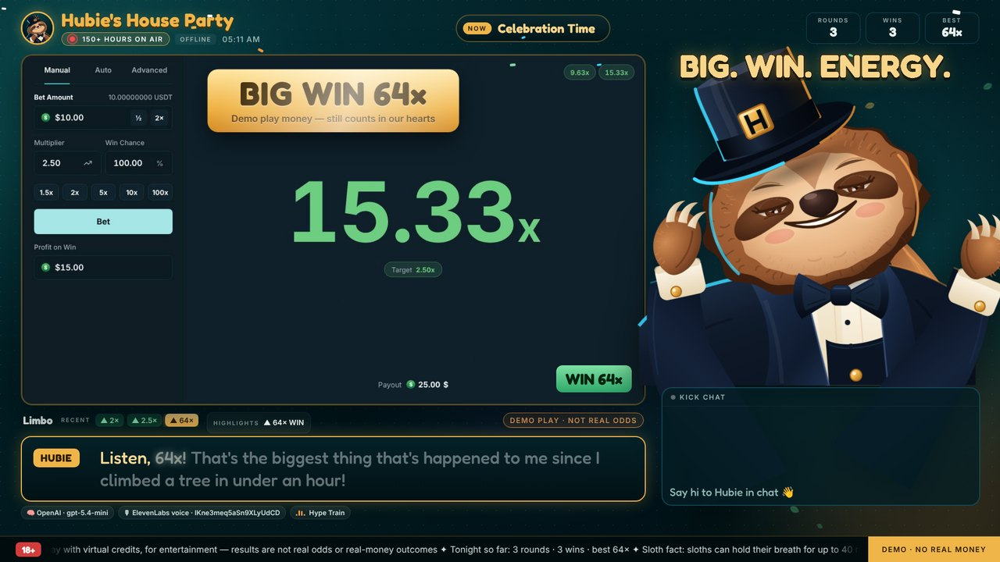

*The 1920×1080 stream overlay, captured from the running application.*

</div>

---

## Introduction

**Hubie** is a character-driven AI host: a sloth in a top hat who runs a live **Kick** stream on his own. He plays a play-money **Limbo** game, commentates every round from the real game data, reads and answers Kick chat by username, speaks with an **ElevenLabs** voice with a mouth that follows the actual audio, and reacts with a fully animated body, face and show graphics.

Everything is operated from one web page, the **Hubie Control Center**. Keys, voice, game settings, Kick, OBS, personality, music, avatar and monitoring are all configured there, with a live health state next to each item.

> **Designed so even a complete beginner can deploy and manage the system. If you can follow a few simple instructions, you can get it running.**
> Double-click one file (Windows) or run one command (Mac / Linux / server), then work down a numbered list in your browser. You never edit source code or configuration files.

> **Please read — honest labelling.** Hubie's Limbo is a **local entertainment game with virtual credits**. It is **not connected to Housebets or any casino**, uses **no real money**, and its win-heavy distribution is **not any operator's real odds**. The overlay carries a permanent "Demo play · not real odds" note plus 18+ and responsible-gambling notices, and these cannot be switched off from the control panel.

---

## Main features

| | Feature | What it does |
|---|---|---|
| 🎛️ | **Beginner-friendly Control Center** | 16 numbered sections, each with a clear state: *Ready · Connected · Not configured · Testing · Failed*. A **Check everything** button runs real tests before you go live. |
| 🎭 | **A character, not a TTS bot** | Quick-witted personality with nine rotating humour styles, short-term chat memory, tone understanding (jokes, teasing, praise, criticism) and a repetition guard. The top hat is only mentioned when a viewer brings it up. |
| 🎲 | **Real-data commentary** | Hubie comments on what actually happened. A cryptographic RNG decides each Limbo round, the page only animates the engine's answer, the agent reads it back and rejects any mismatch, and every commentary line is checked against the real numbers. |
| 💬 | **Chat that answers by name** | Official Kick API chat in and out, with moderation (spam, links, abuse, prompt-injection attempts). |
| 🗣️ | **ElevenLabs voice with automatic failover** | Add as many backup keys as you like. Hubie switches on out-of-credits, rate limits, bad keys and outages, detects keys that share one account allowance, and falls back to a free local voice (or silence) without ever switching to another paid provider. |
| 🦥 | **Animated avatar** | Ten behaviour states (idle, speaking, listening, thinking, laughing, excited, surprised, disappointed, celebrating, reacting), blinking and body motion, and lip-sync driven by the real audio. |
| 🎵 | **Background music** | Five original loops (generated by a script in this repo), cross-fading, **automatic ducking** while Hubie talks, mood selection, separate music and voice volumes, recovery from a broken track. You can add your own licensed files. |
| 📺 | **Show graphics** | Event rail, highlights, big-win and near-miss banners, live chat panel, now-playing chip, ambient background motion, and a **150+ HOURS ON AIR** history badge next to an honest LIVE/OFFLINE chip. |
| 🛡️ | **Safety built in** | One-click **emergency stop**, manual confirmation before any public stream, secrets kept server-side, and an output safety filter. |
| 📈 | **Monitoring** | Memory, CPU, event-loop lag, speech queue, voice engine, AI errors and component health in one section. |

---

## Control panel overview

The Control Center opens in your browser after start-up. Work through the sections from top to bottom; each one tells you what to do next and whether it worked.

| # | Section | What you do there |
|---|---|---|
| 1 | **AI brain** | Paste your Anthropic key → **Save & test**. OpenAI can be added as an optional text-only backup. |
| 2 | **Voice** | Paste your ElevenLabs key, press ▶ to audition voices, **Select**, adjust stability / style / speed, set volume. |
| 3 | **Limbo game** | Round delay, bet, targets, outcome weights; pause / restart; watch recent results. |
| 4 | **Kick chat** | Guided numbered steps: app details → sign in → public address → paste address → subscribe → test. |
| 5 | **Kick stream** | Stream URL + key, title, category. Going public is the last step and always needs your confirmation. |
| 6 | **OBS** | Connect OBS, one-click scene set-up, 1080p60 settings. |
| 7 | **Audio test** | Play a test line; shows provider, volume and any error. |
| 8 | **Avatar & look** | Try expressions and animations; title, size and layout. |
| 9 | **System health** | Every component with its state and last problem. |
| 10 | **Pre-stream checklist** | **CHECK EVERYTHING**, then **START HUBIE**. |
| 11 | **Cloud (Streamable)** | Settings for running the overlay inside Streamable's cloud OBS. |
| 12 | **Personality** | Humour, sarcasm, friendly roasting, commentary amount, chat frequency, hat policy, memory length. |
| 13 | **Voice keys & music** | Backup ElevenLabs keys (add, test, reorder, enable/disable), failover history, music and ducking controls. |
| 14 | **Avatar animation** | Intensity, idle life, gestures, reactions; live state badge and preview buttons. |
| 15 | **Streaming / ON AIR** | Confirmed-live status, measured live time, session history, history-badge text. |
| 16 | **Monitoring** | Memory / CPU trend, queues, voice and AI health. |

A red **EMERGENCY STOP** button stays at the bottom of the sidebar at all times.

---

## Screenshots and visual preview

All images below are real captures of the running application (headless Chrome driving the real controller and overlay). The capture environment could not reach ElevenLabs, Kick or OBS, so a stand-in ElevenLabs server was used for the voice, and Kick and OBS are shown **unconfigured, exactly as on a fresh install**. The AI commentary seen in the overlay capture comes from the real Anthropic API. The script that produced them is [`scripts/capture-readme-screenshots.ts`](scripts/capture-readme-screenshots.ts).

### The stream overlay

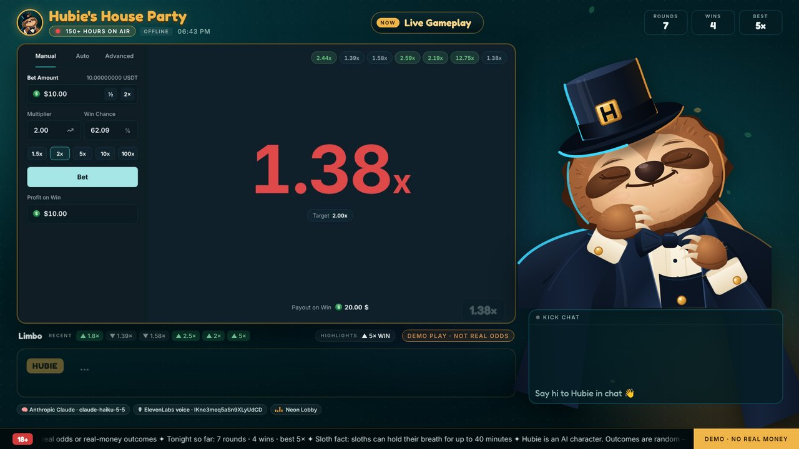

*Game panel, recent-results rail, Hubie with subtitles, chat panel, status chips, "150+ HOURS ON AIR" history badge, and the permanent demo / 18+ notices.*

### Control Center

| | |
|---|---|
| 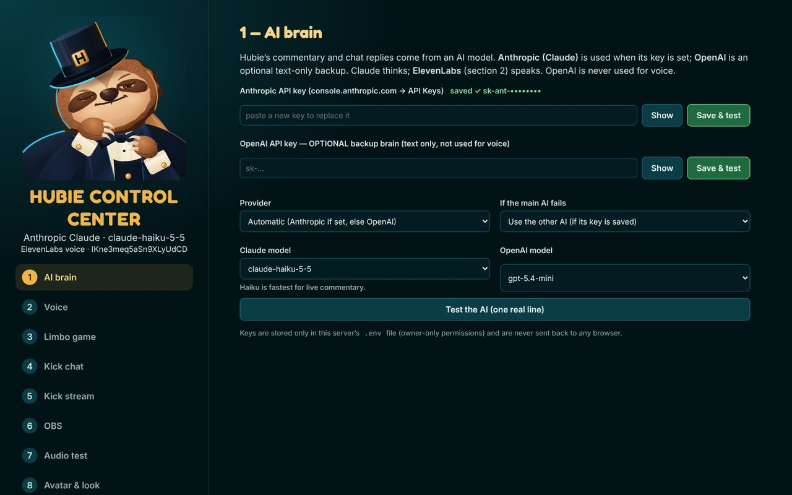<br>**1 · AI brain** — key is masked after saving and never sent back to the browser. | 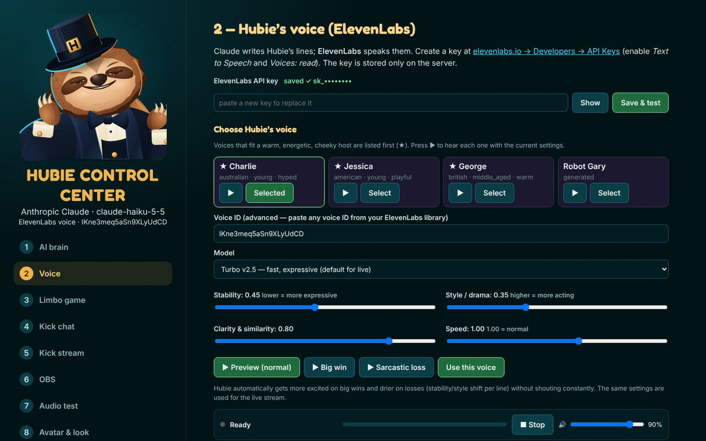<br>**2 · Voice** — audition voices, tune delivery, adjust volume. |
| 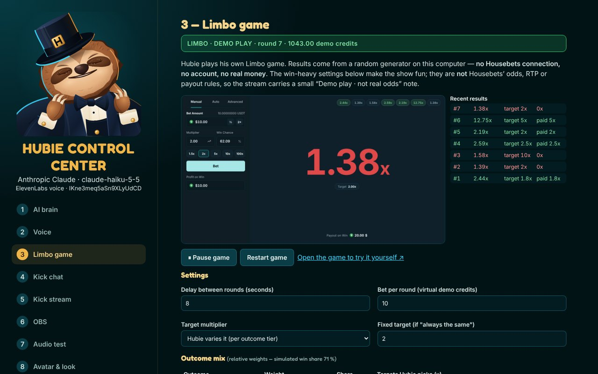<br>**3 · Limbo game** — live preview, recent results and every setting. | 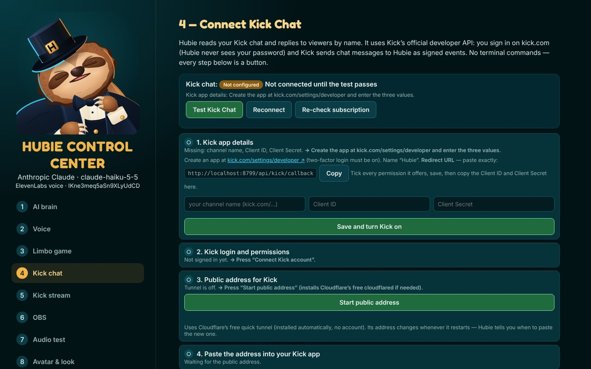<br>**4 · Kick chat** — a guided checklist; every step is a button. |
| 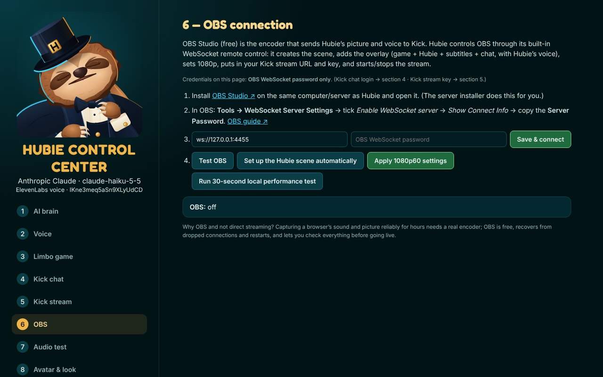<br>**6 · OBS** — connection, automatic scene, 1080p60 settings. | 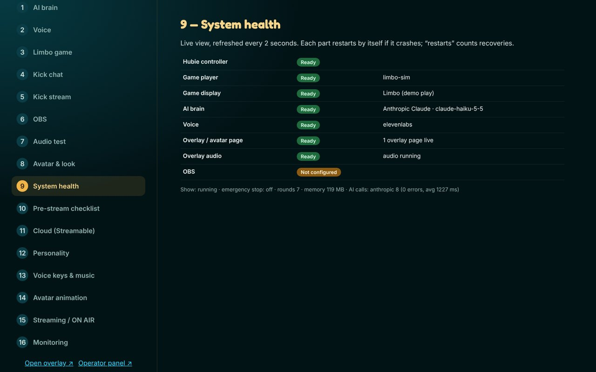<br>**9 · System health** — each component's state and last problem. |
| 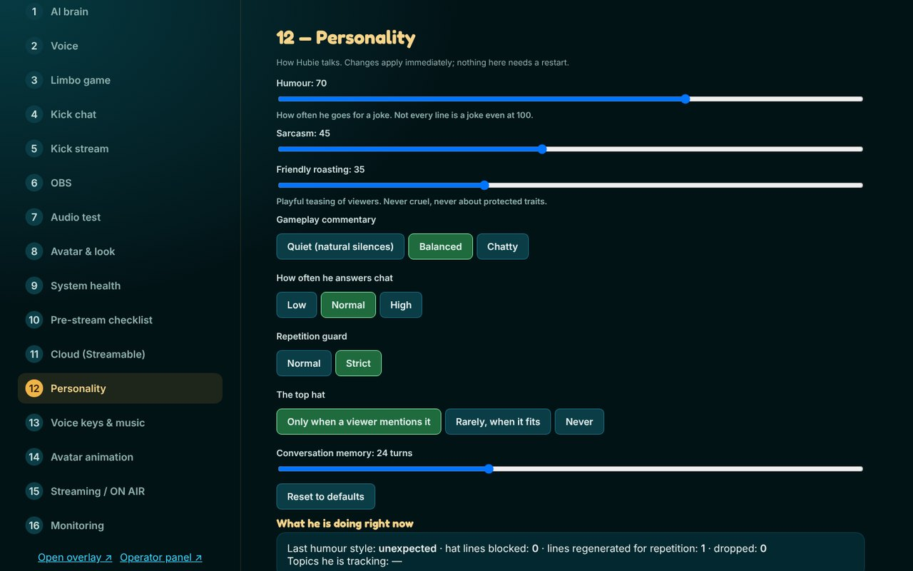<br>**12 · Personality** — humour, sarcasm, commentary, hat policy. | 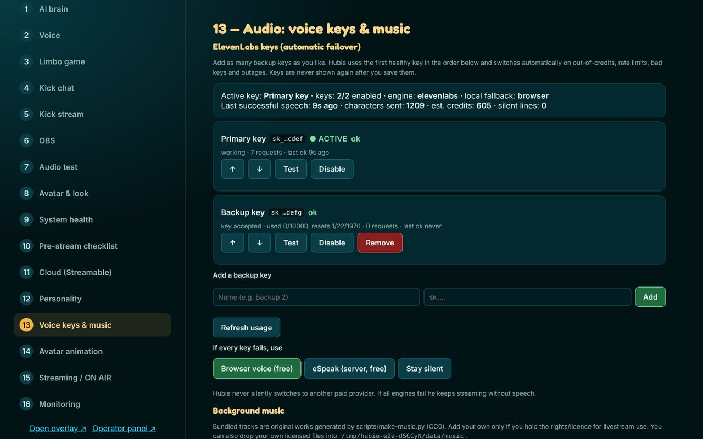<br>**13 · Voice keys & music** — backup keys with automatic failover. |
| 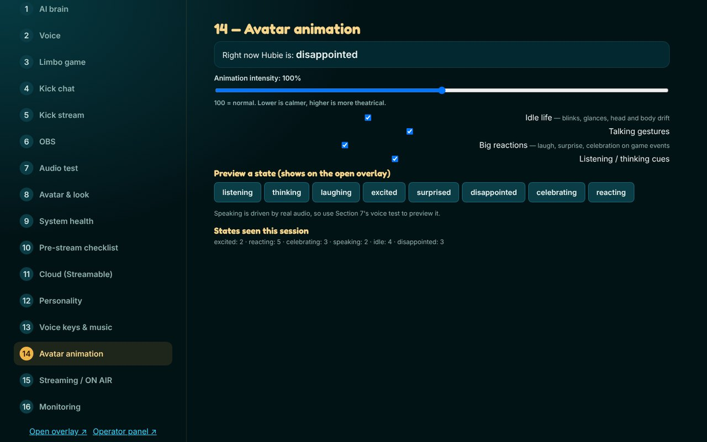<br>**14 · Avatar animation** — intensity, reactions, live state. | 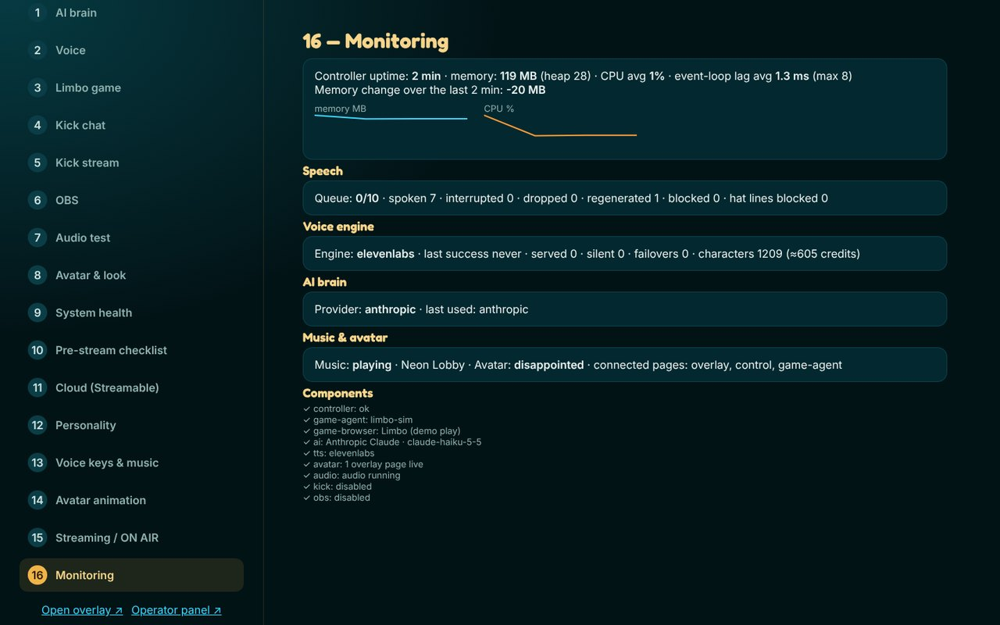<br>**16 · Monitoring** — memory, CPU, queues, engine health. |

---

## Easy installation and deployment

You need **Node.js 22.13 or newer** (free, from [nodejs.org](https://nodejs.org)). The start scripts check this for you and tell you what to do if it is missing.

### 1 · Get the repository

```bash
git clone <your-repository-url> hubie-streamer
cd hubie-streamer
```

(Or download the repository as a ZIP, unzip it, and open the folder.)

### 2 · Start it

| Where | How |
|---|---|
| **Windows** | Double-click **`START-HUBIE.bat`** |
| **Mac / Linux** | `./start-hubie.sh` |
| **Server (Ubuntu 22.04 / 24.04)** | `bash INSTALL-HUBIE.sh` (as root) — see [docs/VPS-DEPLOYMENT.md](docs/VPS-DEPLOYMENT.md) |
| **Any OS, manually** | `npm install && npm start` |

On first run the script installs the dependencies (a few minutes), builds the overlay and opens the Control Center at **http://127.0.0.1:8787/setup**. Keep the terminal window open; closing it stops Hubie.

### 3 · Configure in the browser

Work down the Control Center: paste your Anthropic key (section 1) and ElevenLabs key (section 2), optionally tweak the game (3), connect Kick (4–5) and OBS (6), then open section 10 and press **CHECK EVERYTHING**. Until keys are saved, Hubie runs in **demo mode** with built-in lines and a browser-voice fallback, so you can look around immediately.

Step-by-step guides with the exact buttons to press:
[Beginner setup](docs/BEGINNER-SETUP.md) · [Anthropic](docs/ANTHROPIC-SETUP.md) · [ElevenLabs](docs/ELEVENLABS-SETUP.md) · [Kick](docs/KICK-SETUP.md) · [OBS](docs/OBS-SETUP.md) · [Server](docs/VPS-DEPLOYMENT.md) · [Streamable cloud](docs/STREAMABLE-CLOUD.md)

### 4 · Go live, and stop

Section 10 → **START HUBIE**. Going public always requires a manual confirmation; Hubie never starts a public stream by itself. Stop with **STOP HUBIE & stream** in the panel, with **EMERGENCY STOP**, or with `npm run estop`.

### Server installer

On a fresh Ubuntu server, `INSTALL-HUBIE.sh` installs Node.js, PM2 (auto-restart), the game browser and headless OBS Studio, turns on a firewall that keeps SSH open, creates a private access token and a helper command (`hubie`), and prints your private Control Center link. It never buys or provisions anything and never goes live by itself.

---

## Configuration guide

**You normally never edit configuration by hand** — the Control Center writes it for you. For reference, settings live in `.env` (created from [`.env.example`](.env.example); owner-only permissions; never commit it).

| Setting | Purpose |
|---|---|
| `ANTHROPIC_API_KEY`, `ANTHROPIC_MODEL` | Hubie's brain (default model `claude-haiku-5-5`). |
| `OPENAI_API_KEY` | Optional text-only backup brain. Never used for voice. |
| `ELEVENLABS_API_KEY`, `ELEVENLABS_VOICE_ID`, `ELEVENLABS_MODEL` | Hubie's voice. Extra backup keys are added in section 13 and stored separately in `data/elevenlabs-keys.json`. |
| `TTS_FALLBACKS` | If every ElevenLabs key fails: `browser` (default), `espeak`, or `none` (stay silent). |
| `KICK_*` | Official Kick developer-app details and webhook settings (set through section 4). |
| `OBS_WS_URL`, `OBS_WS_PASSWORD`, `OBS_SCENE` | OBS WebSocket connection (set through section 6). |
| `CONTROLLER_PORT` | Port of the Control Center (default `8787`). |
| `CONTROL_TOKEN` | Needed to open the Control Center from another computer (the server installer generates it). |
| `AUTO_START` | Start the show automatically when the app starts. |

Game behaviour (round delay, bet, targets, outcome weights) is in section 3 and stored in [`config/limbo-sim.json`](config/limbo-sim.json). The personality, music, avatar and history-badge settings are stored in Hubie's local database and edited in sections 12–15.

### Security in plain words

- Keys are stored **only** on the machine running Hubie. After saving, the browser shows only a masked hint (for example `sk-ant-••••••••`); keys never appear in browser code, network responses to the page, logs or screenshots.
- From another computer, the Control Center requires the private link containing the access token. Proxied requests are never treated as local.

---

## Compatibility and requirements

| Area | What is supported | How far it has been verified |
|---|---|---|
| **Runtime** | Node.js **≥ 22.13** (declared in `package.json`). | Node 22 on Linux. |
| **Operating systems** | Windows (`START-HUBIE.bat`), macOS and Linux (`start-hubie.sh`), Ubuntu 22.04/24.04 server (`INSTALL-HUBIE.sh`). | **All automated testing was done on Linux.** The Windows and macOS launchers are provided but were not run on those systems here. |
| **Browsers** | The control panel and overlay run in Chromium-based browsers; OBS's browser source is Chromium. The game page is driven by Playwright. | Tested in Google Chrome (headless, via Playwright). Other browsers are not tested. |
| **Screen sizes** | Control Center collapses to a single column on narrow screens (≤ 900 px). The overlay is a fixed **1920×1080** stream page. | Layout checked at 1440×900 and 1920×1080; phone layouts not tested. |
| **Streaming** | **Kick** through its official public API (OAuth 2.1 + PKCE, REST, signed webhooks). Encoder: **OBS Studio** via obs-websocket v5, or **Streamable's cloud OBS** using the overlay as a browser source. | See the next section. |
| **AI** | Anthropic Claude (primary); OpenAI text models (optional backup). | Anthropic tested live; OpenAI against a stand-in. |
| **Voice** | ElevenLabs; free local fallbacks (browser voice, optional eSpeak). | ElevenLabs against a stand-in. |
| **Chat tunnel** | Cloudflare's free quick tunnel (`cloudflared`) for Kick webhooks on a home computer; a server uses its own public address. | Not testable from the build machine. |

**Hardware guide for a server:** about 4 vCPU / 8 GB RAM for 1080p encoding on the same machine (see the server guide); the Streamable mode moves rendering and encoding off your computer.

### What has — and has not — been tested

- **Automated:** 200 unit tests plus end-to-end suites in a real browser (show chain, failure recovery, audio, Control Center, key failover, music/ducking, ON AIR badge, restart persistence, frame rate). Full results: [docs/TEST-RESULTS.md](docs/TEST-RESULTS.md).
- **Real services:** only the **Anthropic** integration was tested against the live API. **ElevenLabs, Kick, Streamable and OBS** were tested against stand-in servers because the build machine could not reach them, so they should be rehearsed privately before a public stream.
- **Longest continuous run:** 8 minutes with a stand-in brain and 6 minutes with the real Claude brain (no errors, flat memory). A multi-day run has **not** been performed.
- The background music was measured, not listened to; please judge it by ear.

---

## How it works

```
Kick chat ──► kick-agent ──┐                       ┌──► overlay page (OBS / Streamable browser source)
                           ▼                       │      avatar · game frames · subtitles · music · voice
game page ◄── game-agent ► controller (hub) ───────┤
(Limbo demo)               │  director · speech queue
                           │  AI brain (Claude) ► safety filter ► voice (ElevenLabs → fallback)
                           ▼
                      SQLite memory ·  Control Center (/setup)
```

1. **Game round.** The game agent triggers a Limbo round; a cryptographic RNG decides the result; the page animates it; the agent reads it back and rejects any mismatch.
2. **Structured event.** The controller turns the real result into an event (win, near miss, streak …). This event is the only source of numbers.
3. **Commentary.** Claude writes a line using the event, the personality settings and recent conversation. A fact checker corrects any number that disagrees with the event; a variety guard blocks repeats; a hat guard enforces the hat policy.
4. **Safety, then voice.** The line passes the safety filter, is spoken by ElevenLabs (failing over across your keys, then to the local voice), and the overlay plays the audio with lip-sync while the music ducks.
5. **Chat.** Kick messages arrive as signed webhooks, are moderated, classified (question, joke, praise …) and answered by username.
6. **Honest status.** The overlay shows LIVE only while Kick (or OBS) confirms the stream is live. The **150+ HOURS ON AIR** badge is a separate, static history badge: it represents Hubie's established broadcasting history across earlier streams, is not a session timer, and is not reset by disconnects. It is a figure the operator states — Hubie does not measure it. Hubie separately tracks the confirmed-live time it has actually measured (section 15).

Deeper detail: [docs/ARCHITECTURE.md](docs/ARCHITECTURE.md) · [docs/AVATAR-AND-VOICE.md](docs/AVATAR-AND-VOICE.md) · [docs/ENTERTAINMENT-UPGRADE.md](docs/ENTERTAINMENT-UPGRADE.md).

---

## API and integrations

| Integration | Used for | Notes |
|---|---|---|
| **Anthropic Claude** (`@anthropic-ai/sdk`) | Commentary and chat replies | Primary brain. |
| **OpenAI** (`openai`) | Optional text-only backup brain | Never used for voice. |
| **ElevenLabs** | Voice | Multiple keys, automatic failover, usage and failover dashboard. |
| **Kick public API** | Chat in/out, channel status | Official endpoints only; no scraping and no unofficial authentication. |
| **OBS Studio** (`obs-websocket-js`, v5) | Scene set-up, 1080p60 settings, start/stop streaming | Local or server OBS. |
| **Streamable Remote OBS** | Cloud rendering/encoding | Overlay is used as a browser source. Streamable has no public control API that we could find, so you press Start there; Hubie does not claim otherwise ([details](docs/STREAMABLE-CLOUD.md)). |
| **Cloudflare quick tunnel** | Public address for Kick webhooks from a home PC | Started and checked from section 4. |

The controller also serves the pages the stream uses: `/setup` (Control Center), `/overlay` (1920×1080 stream page), `/control` (operator panel) and `/avatar` (Hubie alone on a transparent background). The control panel talks to the controller over a local HTTP API (`/api/...`); access from other machines requires the access token.

---

## Architecture and technology stack

| Layer | Technology |
|---|---|
| Language / runtime | TypeScript on Node.js 22 (run with `tsx`) |
| Overlay and Control Center | React 19 + Vite, Web Audio, SVG avatar rig with a custom animator |
| Messaging | WebSocket hub (`ws`) between controller, agents and overlay pages |
| Game agent | Playwright driving the local Limbo page |
| Memory | SQLite (`node:sqlite`): viewers, recent lines, rounds, settings, live-time history |
| Process management | Built-in supervisor locally, PM2 on servers |
| Testing | Vitest, plus Playwright end-to-end suites with stand-in servers |

Repository layout:

```
apps/            controller · game-agent · kick-agent · stream-engine · avatar (overlay + Control Center)
services/        ai (persona, personality, humour, memory) · tts (ElevenLabs, key ring, fallbacks) · lipsync · memory · safety
packages/        shared (protocol, config) · game-adapters (Limbo engine)
assets/          avatar art, original music loops, Limbo page
config/          limbo-sim.json, PM2 ecosystem
docs/            setup guides, architecture, test reports, screenshots
scripts/         installers, music generator, screenshot capture
tests/           unit, end-to-end, stand-in servers
```

---

## Troubleshooting

| Symptom | What to try |
|---|---|
| Start script says Node is missing or too old | Install the current **LTS** from [nodejs.org](https://nodejs.org) and run the script again. |
| Browser doesn't open | Go to `http://127.0.0.1:8787/setup` yourself. |
| Hubie uses canned lines | No Anthropic key is saved, or the account has no credit. Section 1 → **Test the AI** shows the exact reason. |
| Hubie's voice is the browser voice | ElevenLabs key missing, out of credits or invalid. Section 13 shows every key's state and the last error. |
| No sound on stream | Open the overlay once (or use OBS **Set up scene**); section 7 shows whether any overlay page is playing audio. |
| Kick chat not connected | Follow section 4's numbered steps; each failing step says what to press next. |
| Something odd | Section 9 (health) and section 16 (monitoring) show each component's last problem. |
| Need silence now | **EMERGENCY STOP** (sidebar) or `npm run estop`. |

More: [docs/TROUBLESHOOTING.md](docs/TROUBLESHOOTING.md).

---

## Future improvements

- A multi-day soak run and long-run reliability report.
- Testing and polishing the Windows and macOS launchers on those systems.
- Verified end-to-end rehearsals with live ElevenLabs, Kick and Streamable accounts.
- Streamable cloud control, if Streamable publishes an API.
- A listening pass on the bundled music and more track variety.
- Further tuning of the commentary variety in long sessions.

---

## Housebets contest submission context

This repository is our submission to the **Housebets contest**. It is an autonomous AI streamer built around a local demo game. To be explicit about what it is and is not:

- It **does not connect to Housebets** or any operator, account or payment system, and involves **no real money**.
- The Limbo game is Hubie's own local page with virtual credits and a configurable, win-heavy distribution for entertainment; it does not represent any operator's odds, RTP or payout rules.
- 18+ and responsible-gambling messaging and a "Demo play · not real odds" note are always on screen; Hubie never promises wins or encourages deposits.

---

## Credits and acknowledgements

- **Hubie Live** — concept, engineering, art direction and documentation by the Hubie team.
- Built with [Anthropic Claude](https://www.anthropic.com), [ElevenLabs](https://elevenlabs.io), [Kick](https://kick.com), [OBS Studio](https://obsproject.com), [React](https://react.dev), [Vite](https://vitejs.dev), [Playwright](https://playwright.dev) and [Fredoka](https://fonts.google.com/specimen/Fredoka) / [Inter](https://rsms.me/inter/) via Fontsource.
- Background music: original loops generated by `scripts/make-music.py` (CC0).

### Licence

No open-source licence is granted with this repository: the package is marked private and no `LICENSE` file is included, so all rights are reserved by the authors. Add a licence file if you decide to publish it under one.
