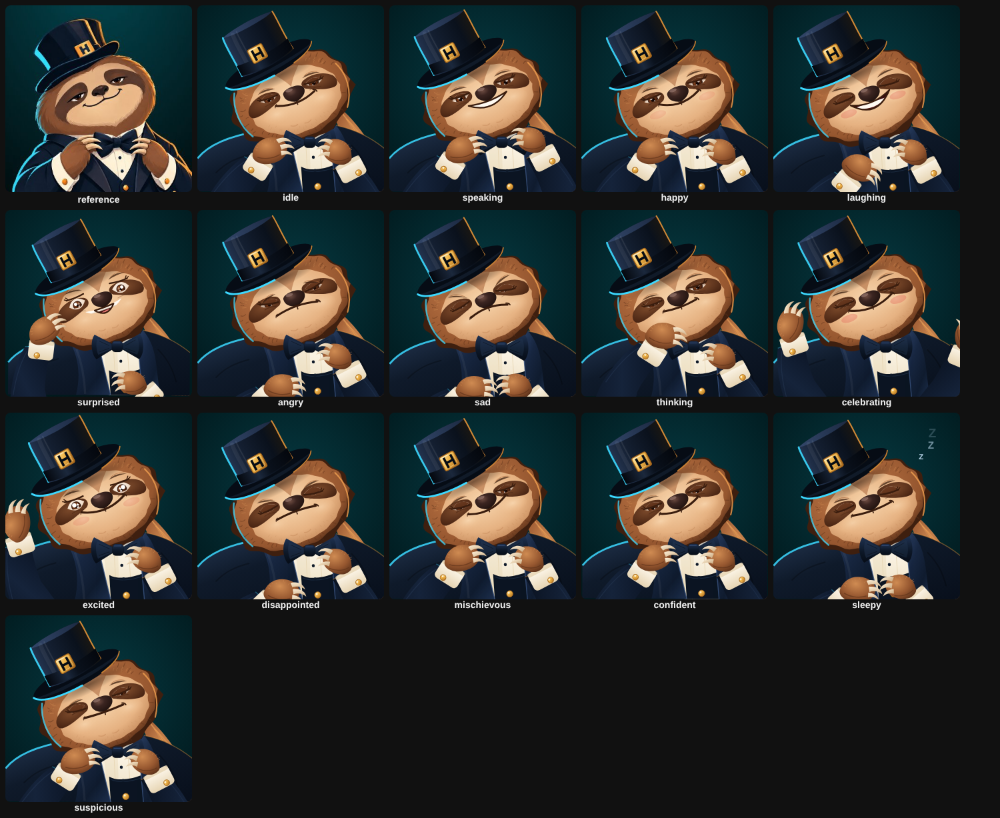
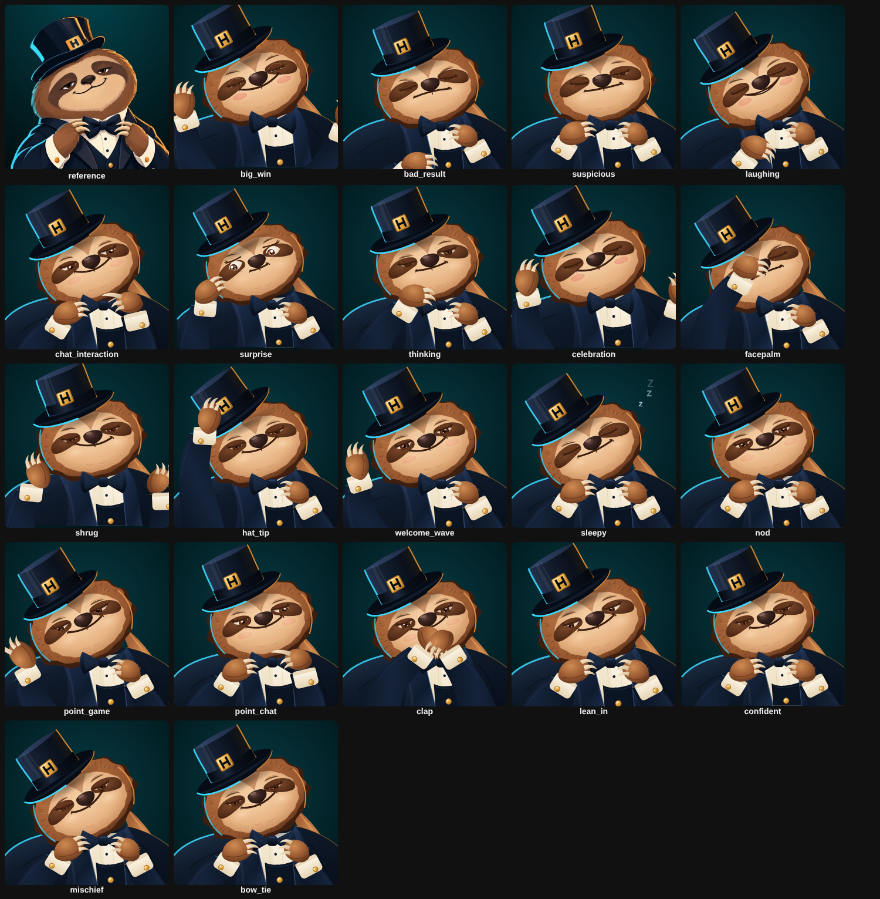

# Avatar, animation, voice and brain

## The avatar

Hubie is a **layered, shaded vector rig** traced from `assets/hubie/hubie-reference.png`. Source: `apps/avatar/src/rig/HubieSvg.tsx`. It keeps the reference's identity: the black top hat with the gold H, the tuxedo, the white shirt, the dark bow tie, and the brown, cream and cyan palette.

Visual details:
- Fur: radial gradient shading, hand-placed fur strands, rim lights (cyan and orange, as in the reference).
- Eyes: gradient sclera, layered iris with limbus and pupil, two specular highlights plus a sparkle, lid shadow, lashes.
- Face: cheeks that lift when he smiles, soft ambient-occlusion shadows (hat brim, chin, ground).
- Clothing: satin lapels, shirt pleats, fabric folds, a gold-gradient H badge, cufflinks and buttons with highlights.
- Performance: no SVG filters on moving parts, so it stays cheap enough for OBS at 60 fps.

### Degrees of freedom

| Area | Parameters |
|---|---|
| Head | tilt, nod, turn (fake 3/4), drift |
| Body | breathing, lean forward / back, bounce, shoulders, laugh shake |
| Eyes | gaze x/y, upper and lower lids **per eye**, wide-eye, sparkle |
| Brows | height and inner-tilt **per brow** (independent) |
| Mouth | open, wide, round, smile/frown, smirk asymmetry |
| Cheeks and blush | cheek lift, blush |
| Hat | tilt, lift, slide |
| Arms ×2 | rotation, offset, wrist rotation, pointing claw |
| Extras | bow-tie wiggle, sleepy Z's |

### Expressions (15)

`idle` · `speaking` · `happy` · `laughing` · `surprised` · `excited` · `celebrating` · `angry` · `sad` · `disappointed` · `thinking` · `mischievous` · `confident` · `sleepy` · `suspicious`

### Animation combos (21)

Combos are timed, multi-track sequences: `apps/avatar/src/rig/combos.ts`. Examples:
- **big_win:** eyes widen, brows shoot up, mouth opens, he leans back, then both paws lift with a bouncing body. Confetti, hat lift.
- **bad_result:** eyes narrow, head tilts, shoulders drop, disappointed look.
- **suspicious:** squint, one brow up, slow head tilt, looks at the viewer.
- **laughing:** squinting eyes, cheek lift, open–close mouth, head and body shake, paw on belly.
- **chat_interaction:** looks toward chat, points, then waves.
- Also: `surprise`, `thinking`, `celebration` (paws up, then clapping), `facepalm`, `shrug`, `hat_tip`, `welcome_wave`, `sleepy`, `nod`, `point_game`, `point_chat`, `clap`, `lean_in`, `confident`, `mischief`, `bow_tie`.

### The animation director

`apps/avatar/src/rig/animator.ts` combines several layers **per channel** (face, head, body, left arm, right arm, gaze, hat):
1. The base expression.
2. Procedural life: breathing and head drift.
3. Idle behaviours at random intervals: glances at the game, chat or viewer, hat and bow-tie adjusts, slow sleepy blinks, head tilts, nods.
4. Speech:
   - the mouth is driven by the audio;
   - a wide syllable after a pause triggers an emphasis nod;
   - the free paw makes talk gestures, scaled by the line's emotion.
5. Combos: the newest combo owns the channels it uses, and only those, so a pointing gesture never stops a smile.
6. Blinks: normal, double, or slow and sleepy.

Body, head, arms and hat move on **springs** with slight overshoot, so motion feels alive rather than mechanical. Face and mouth use fast critical damping.

**Limitations:**
- He's a stylised vector redraw, not the painted original.
- The 3/4 head turn is faked with feature shifts.
- The claws don't articulate individually.
- Mouth shapes come from audio analysis, not phoneme alignment.

## The voice (ElevenLabs)

- **Endpoint:** `POST /v1/text-to-speech/{voice_id}` (MP3 44.1 kHz) with your key in the `xi-api-key` header; the key stays on the server.
- **Model:** default `eleven_turbo_v2_5` (`ELEVENLABS_MODEL`; `eleven_flash_v2_5` and `eleven_multilingual_v2` also selectable).
- **Voice:** default **Charlie** (energetic, warm, playful, clear); choose any voice from your account in Control Center → 2, where each card has a ▶ preview. Recommended ones are starred. Details: [ELEVENLABS-SETUP.md](ELEVENLABS-SETUP.md). This is a stock/library voice, not a clone.
- **Personality:** `services/tts/src/voicePersonality.ts` holds the base delivery (stability 0.45, similarity 0.8, style 0.35, speed 1.0) and the per-emotion adjustments, clamped so the voice is expressive but never constantly shouting.
- **Emotion per line:** the commentary brain picks one of 14 emotions, and each shifts stability/style and speed for that line:

| Emotion | Used for | Delivery |
|---|---|---|
| relaxed / friendly | normal play, chat | easygoing / warm greeting |
| excited / hyped | wins / big wins, celebrations | energetic / highly energetic |
| sarcastic | bad results | dry deadpan with a twist |
| surprised | unexpected events | rising pitch, disbelief |
| playful | jokes | teasing, bouncy |
| calm | serious info, responsible-gambling reminders | clear and steady |
| suspicious, mischievous, dramatic, disappointed, sleepy, warm | flavour | — |

**Playback and lip-sync:**
- Audio plays through WebAudio in the overlay, and an `AnalyserNode` drives the mouth from the **actual audio**: loudness sets how open the jaw is, the frequency balance chooses wide (ee/s) or round (oo/o) shapes.
- Only one line plays at a time. A big moment can interrupt small talk: the old audio stops before the new one starts.

**Efficiency and fallback:**
- Identical lines reuse **cached audio**.
- There is an hourly character cap (`ELEVENLABS_MAX_CHARS_PER_HOUR`).
- If ElevenLabs fails, Hubie falls back to the browser voice, labelled "Browser voice (fallback — not ElevenLabs)", and health shows **degraded** with the reason. The show doesn't stop.
- The robotic espeak voice is **not** used unless you explicitly add it to `TTS_FALLBACKS`.

## The brain (Anthropic Claude; OpenAI optional backup)

- **API:** `client.responses.create` (Responses API) with **structured output** (strict JSON schema): `text`, `emotion`, `expression`, `combo`, `caption`.
- **Model:** default `gpt-5.4-mini` with low reasoning effort, to keep live commentary fast. Configurable with `OPENAI_MODEL` and `OPENAI_REASONING_EFFORT`.
- **Prompt isolation:** the persona and rules are the only `instructions`. Everything else is passed as JSON data in `input`, with chat marked untrusted.

**Context for each line:**
- recent game events;
- recent chat;
- Hubie's own last 15 lines and recent captions;
- session facts for callbacks ("we hit a 25x on round 12", "we survived a 6-round losing streak");
- running jokes with how often each has been used;
- viewer notes ("from Brazil");
- a rotating **style hint**: a dry one-liner, an everyday sloth comparison, addressing chat, building anticipation, a callback…

**Repetition prevention** (`services/ai/src/variety.ts`). Each line is checked against the last 100 lines for:
- near-duplicate wording;
- a reused opener;
- a bare filler ("Nope.", "Oh no.", "Interesting.", "Let's go.").

A failing line is regenerated with an explicit "avoid" list. A low-priority line that still can't be fresh is **dropped**, never repeated.

**Spontaneity, rationed:**
- short stories, observations, questions to chat, sloth jokes, callbacks, anticipation, hat bits;
- at most one about every 70 seconds after routine rounds;
- after long silences only. Silence is allowed.

**Every round gets commentary.** Two routine rounds may share one line ("Back to back: a miss at 1.4x, then a 2x win…") so he doesn't narrate every second.

**Demo mode / fallback:** with no key, or during an outage, a large hand-written compositional line bank speaks instead, screened by the same repetition guard. Over 300 simulated rounds it stays at least 90% unique, with no bare fillers (unit test).

**Cost control:** `OPENAI_MAX_LLM_CALLS_PER_HOUR` (default 900), `max_output_tokens`, and `store: false`.
